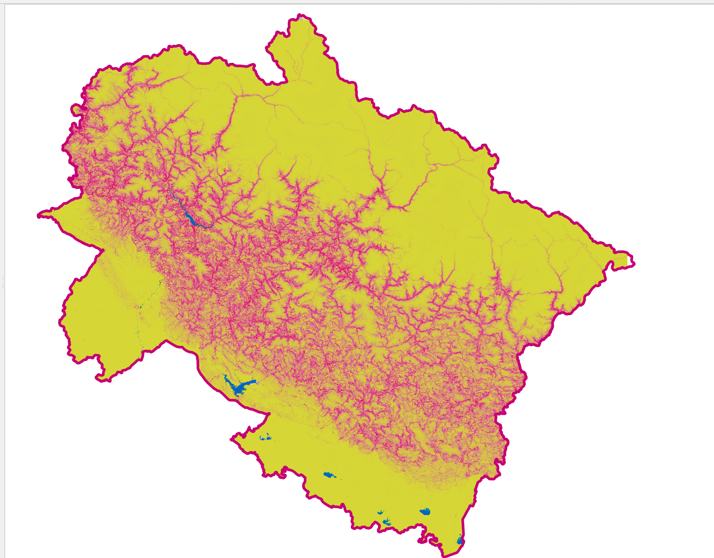
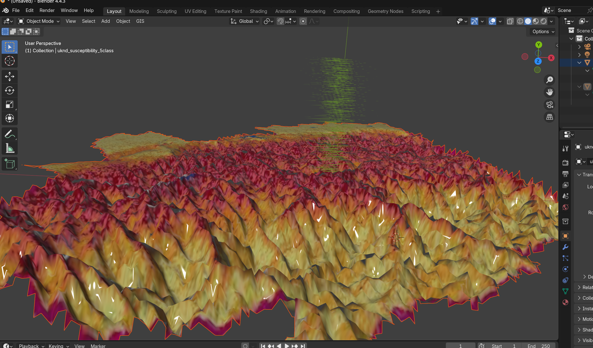
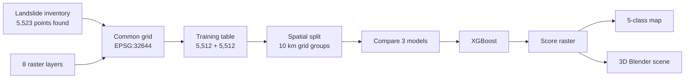
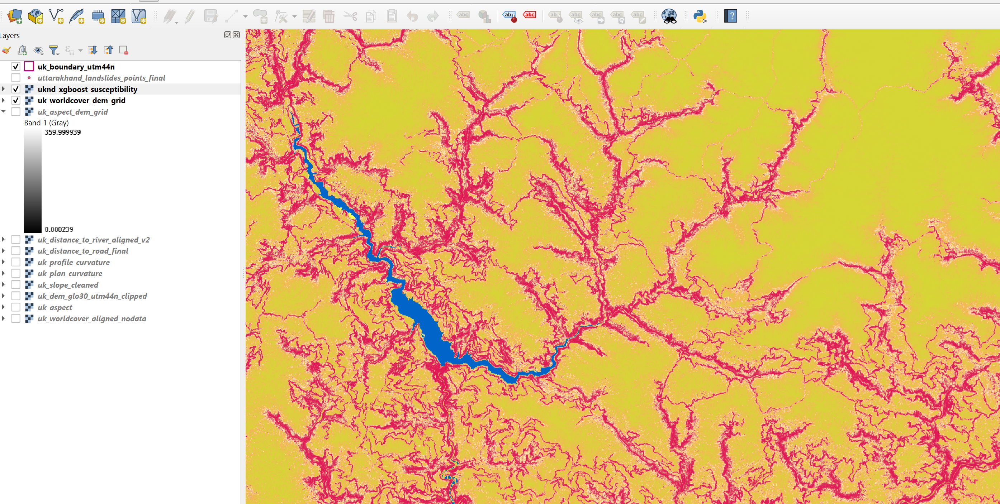
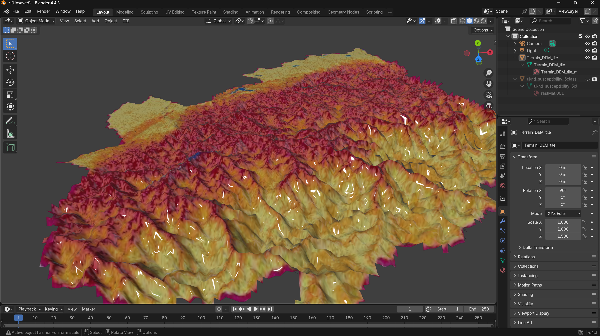
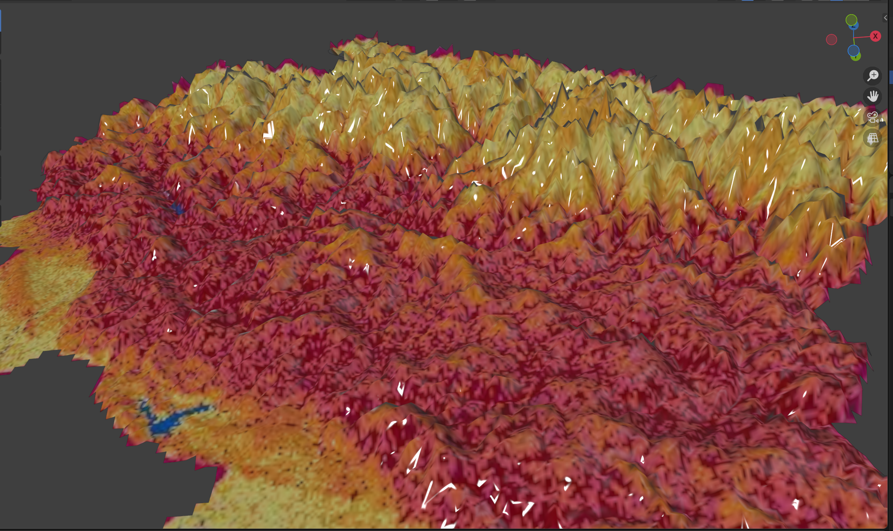

# HimaDrishti: The Himalayan Eye 👁️
***Geospatial Intelligence for Himalayan Hazard Assessment***
---
**A landslide susceptibility map for Uttarakhand, built from 5,512 recorded landslides, eight terrain and distance layers, and a lot GIS and ML workflows.**


Hi, I'm Srijan. UKND started with a simple question: which slopes in Uttarakhand look like the ones where landslides have already happened? The first full version now answers it. It reads eight map layers, learns from recorded landslide locations, and paints the whole state with a susceptibility score. There is a 2D map set and a 3D Blender terrain scene too.

> [!IMPORTANT]
> UKND is a research project for screening and exploring. It does not tell anyone when a landslide will happen. Please read the [limits](#what-the-results-do-not-say) before quoting any number from this page.

---

## At a glance

| | |
|---|---|
| Training table | 11,024 samples: 5,512 recorded landslides and 5,512 background samples |
| Predictors | 8 (elevation, slope, aspect, profile curvature, plan curvature, land cover, distance to road, distance to river) |
| Map grid | 11,759 × 10,715 cells, about 28.4 m per cell, EPSG:32644 |
| Valid cells predicted | 66,012,548 |
| Models compared | XGBoost, CatBoost, Random Forest |
| Winner | XGBoost, spatial cross-validation ROC-AUC 0.9497 ± 0.0048 |
| Held-out spatial test | ROC-AUC 0.9496, balanced accuracy 0.8815 |
| Outputs | continuous score raster, 5-class raster, 2D PDF maps, 3D Blender scene |

---

## Take a look

The predicted susceptibility map, with the 3D terrain version underneath. The full-size PDFs are linked below the pictures.



> [!NOTE]
> **Reading the colours:** the legend goes from pale yellow (very low susceptibility) through amber, orange and pink-red (high) to dark crimson (very high). The deeper the colour, the more a spot resembles places where landslides have been recorded. These are relative model scores, and they are not probabilities. The full legend is in [the maps section](#the-maps).



| Susceptibility map | Recorded landslides |
|---|---|
| [Open the susceptibility map (PDF)](outputs/image/uk_landslide_susceptibility_view.pdf) | [Open the historical landslide points (PDF)](outputs/image/uk_landslide_historical_datapoints.pdf) |
| The model's score for every valid cell, from very low to very high | The recorded landslide points the model learned from |

Two more PDFs sit in the same folder: the [land-cover map](outputs/image/uk_landcover_view.pdf) and the [recorded landslides drawn over the prediction](outputs/image/uk_historical_landslide_data_overlayed_with_predicted_susceptibility.pdf).

---

## Why this project

Uttarakhand is steep young mountain country with heavy monsoon rain. Houses, roads and bridges sit on the same slopes that move. A single slide can cut a highway and leave villages hard to reach.

A few examples from official sources:

- One database (UNDRR DesInventar) lists 301 landslide disaster records for Uttarakhand between 1984 and 2019, with 767 deaths and 3,058 houses damaged.
- The June 2013 disaster combined extreme rain, flash floods and landslides.
- On 5 August 2025, ISRO/NRSC satellite images showed a debris-laden flash flood at Dharali, Uttarkashi, leaving a fan of debris of about 20 hectares.

Many official figures mix landslides with floods and heavy rain, so I don't add them together or call them landslide-only totals.

A map of recorded landslides only tells you where something already happened. UKND asks which other parts of the landscape share similar terrain, so that field inspection and planning can start in the right places.

---

## How it works



1. Put every layer on one shared grid so each map cell means the same place in every layer.
2. Check the data: coordinate system, NoData cells, value ranges.
3. Read the layer values at each landslide location.
4. Add background samples, locations with no recorded landslide.
5. Split the data by map area, train three models, and keep the best.
6. Run the winner over every valid cell, then turn the scores into classes and maps.

A peek at the QGIS workspace used for checking layers and maps:



---

## The data

### Eight predictors

| Layer | What it describes |
|---|---|
| Elevation | Height above sea level (Copernicus GLO-30 DEM, clipped to the project area) |
| Slope | Steepness of the ground |
| Aspect | The direction a slope faces |
| Profile curvature | Curvature along the downhill direction |
| Plan curvature | Curvature across the slope, along the contour |
| Land cover | Class of surface cover, from ESA WorldCover |
| Distance to road | Distance to the nearest mapped road |
| Distance to river | Distance to the nearest mapped river |

### Getting the layers to line up

The clipped DEM is the template grid. Everything else was matched to it.

- **Aspect** is a compass angle, so 0° and 360° are the same direction. I split it into sine and cosine parts, resampled those with bilinear interpolation, then recombined them with `atan2`. A plain resample would have blended 359° and 1° into 180°.
- **Land cover** holds class codes, so it was resampled with nearest neighbour. Averaging class codes would make nonsense classes.
- **Slope, curvature, road and river layers** already matched the grid, apart from floating-point differences far too small to matter (around 10⁻⁹ map units for curvature).

### Checking the points

The inventory had 5,523 landslide points. 5,512 had a valid value in all eight layers. I looked into the other 11 and left them out, without filling any gaps with zeros:

- 9 points had no usable elevation cell (5 outside the raster, 4 on NoData cells)
- 2 points had elevation but no curvature values

### Background samples

> [!NOTE]
> Landslide inventories only list landslides that someone recorded. A spot with no record might be stable, or it might simply never have been reported. So the background samples are locations with no recorded landslide, and I do not treat them as proven safe ground.

The sampling rules call for cells where all eight layers are valid, and the sampling files are kept so the process can be inspected (`data/processed/BG_A/`).

---

## Testing the model fairly

If neighbouring points land in both the training and the test set, the test turns into a memory check, because nearby places look alike. So I split by map area:

- Points were grouped into 10 km grid squares and whole squares were assigned to either train or test (`GroupShuffleSplit`).
- Training: 8,723 samples in 477 groups. Test: 2,301 samples in 120 groups. No group appears in both.

> [!NOTE]
> A 10 km grid does not guarantee a 10 km gap between every training and test point, because two points in neighbouring squares can be close. A stricter buffer test is on my list.

---

## Results

### Choosing a model

| Model | Spatial CV ROC-AUC |
|---|---|
| XGBoost | 0.9497 ± 0.0048 |
| CatBoost | 0.9486 ± 0.0050 |
| Random Forest | 0.9479 ± 0.0044 |

> [!NOTE]
> XGBoost came first, but the gaps are tiny next to the fold-to-fold spread (0.0011 over CatBoost, 0.0018 over Random Forest). I read this as "XGBoost was the best of the three I tried", and I'm not claiming it beats the others by a meaningful margin.

Final settings: 400 trees, max depth 4, learning rate 0.03, subsample 0.8, column sample 0.8, L2 regularisation 2, random seed 42. Land cover is one-hot encoded inside the same pipeline as the model.

### Held-out spatial test

| Metric | Value |
|---|---|
| ROC-AUC | 0.9496 |
| Average precision | 0.9492 |
| Accuracy | 0.8818 |
| Balanced accuracy | 0.8815 |
| Landslide recall | 0.8914 |

| | Predicted background | Predicted landslide |
|---|---|---|
| **Actual background** (1,113) | 970 | 143 |
| **Actual landslide** (1,188) | 129 | 1,059 |

The model found about 89 of every 100 recorded landslide samples in the test areas, and both kinds of mistakes show up in similar amounts.

---

## The maps

The trained model was run over every valid cell. That gave a continuous score from 0.0008 to 0.9985 (mean 0.1825), saved as `uknd_xgboost_susceptibility.tif`.

The classes use this colour scheme in the map and in the QGIS layer `uknd_susceptibility_5class`. The colours run from pale yellow to dark crimson, and the deeper the colour, the higher the susceptibility.

| Code | Colour | Legend label | Hex | Score range |
|---|---|---|---|---|
| 1 |  | Very Low Susceptibility | `#F6E88B` | up to 0.005305 |
| 2 |  | Low Susceptibility | `#F4B942` | 0.005305 to 0.020048 |
| 3 |  | Moderate Susceptibility | `#F28E2B` | 0.020048 to 0.116785 |
| 4 |  | High Susceptibility | `#E85D75` | 0.116785 to 0.346057 |
| 5 |  | Very High Susceptibility | `#A50026` | above 0.346057 |
| 0 | transparent | NoData | none | no valid prediction |

For easier reading, the scores were cut into these five relative classes (`uknd_susceptibility_5class.tif`) using the four cut-points above.

The class numbers rise in the same direction as the colours, from lowest to highest.

> [!IMPORTANT]
> The classes are bands of the model's own score, and the scores are not calibrated probabilities. A score of 0.8 does not mean an 80% chance of a landslide, and the classes are not official hazard zones.

**2D maps** (PDF, in `outputs/image/`):

| Map | What it shows |
|---|---|
| [Susceptibility map](outputs/image/uk_landslide_susceptibility_view.pdf) | The model output across Uttarakhand |
| [Historical landslide points](outputs/image/uk_landslide_historical_datapoints.pdf) | Where the recorded landslides are |
| [Land cover](outputs/image/uk_landcover_view.pdf) | One of the eight inputs, in its geographic setting |
| [Landslide points over the prediction](outputs/image/uk_historical_landslide_data_overlayed_with_predicted_susceptibility.pdf) | A visual check of whether recorded points fall in higher-score areas |

> [!NOTE]
> The last map in that table is a diagnostic view. The same inventory helped build the model, so it works as a sanity check and does not count as independent validation.

**3D scene**: a Blender terrain model with the susceptibility colours draped over the relief (`3d_uk_landslide_susceptibility_model.blend`, plus OBJ/MTL exports). It is a nice way to see ridges and valleys.

> [!NOTE]
> The 3D scene uses the same colour scheme as the 2D map, from pale yellow (very low) to dark crimson (very high). It is a presentation view only, and a good-looking surface says nothing extra about accuracy.






---

## What the results do not say

> [!IMPORTANT]
> For real warnings and evacuation advice, follow IMD and the state disaster authorities.

- **Background samples are not proof of stable ground.** Some may sit on landslides nobody recorded.
- **A score of 0.8 is not an 80% chance of a landslide.** The scores are not calibrated probabilities.
- **Inventories have their own bias.** Recorded landslides tend to cluster near roads and places people visit, and the model may partly learn that.
- **Eight layers leave things out.** There is no rainfall on the day, no soil wetness, no detailed geology, no earthquake shaking and no engineering detail.
- **This is not a forecast or a warning.** It says where terrain is predisposed, and it can't say when.

---

## The research behind it

Before building anything I read 13 research papers and tracked 26 candidate data sources (all of it in the research notes). A few things I took from them:

- Many local studies test with a random split. Neighbouring points then leak between train and test, so scores look better than they should. That is why UKND uses a spatial split.
- Some papers use field notes (for example "toe failure" or "joint failure") as inputs. Those can't be measured for a place nobody has visited, so UKND sticks to layers that exist for the whole state.
- Rainfall works on a different clock. A local study on the NH-108 road between Uttarkashi and Gangnani linked landslides to rain over several days before the event, and it used a single rain gauge. So rainfall thresholds there are a local baseline only.
- Satellite rainfall and forecast models both showed errors over mountains in the 2013 event studies, so they need checking against rain gauges before they drive anything.
- Earthquake-triggered landslides follow different physics, so they stay a separate track.

### The plan: three separate products

| Product | Question it answers | Status |
|---|---|---|
| Susceptibility | Where is the terrain predisposed to slide? | Working (this repo) |
| Rainfall-triggered alert | When do rain conditions get dangerous? | Future. Needs dated landslides, rain records and temporal validation |
| Risk and impact priority | What is exposed if it slides? | Future. Needs population, road and asset data |

---

## What's next

- Start the rainfall work with dated events and rain gauge data
- Expand project to other high-frequency Uttarakhand natural disasters.

---

## Repository guide

```
data/processed/BG_A/        background_samples.csv, eligible_cells_by_block.csv,
                            combined_training.csv, sampling_metadata.json
outputs/image/              the 2D map PDFs plus PNG previews (susceptibility map, 3D views, QGIS workspace)
src/uknd/                   build_datasets.py, validate_input.py, validate_dataset.py,
                            validate_split.py, evaluate_model.py, predict_susceptibility.py,
                            classify_susceptibility.py, analyze_susceptibility.py
```

Main outputs:

| File | What it is |
|---|---|
| `uknd_xgboost_susceptibility.tif` | Susceptibility map constructed from direct xg boost predictions |
| `uknd_susceptibility_5class.tif` | Five-class raster |
| [`uk_landslide_susceptibility_view.pdf`](outputs/image/uk_landslide_susceptibility_view.pdf) | Susceptibility map |
| [`uk_landcover_view.pdf`](outputs/image/uk_landcover_view.pdf) | Land-cover map |
| [`uk_landslide_historical_datapoints.pdf`](outputs/image/uk_landslide_historical_datapoints.pdf) | Recorded landslide points |
| [`uk_historical_landslide_data_overlayed_with_predicted_susceptibility.pdf`](outputs/image/uk_historical_landslide_data_overlayed_with_predicted_susceptibility.pdf) | Recorded points over the prediction |
| [`xg_boost_predicted_uk_landslide_susceptibility_map.png`](outputs/image/xg_boost_predicted_uk_landslide_susceptibility_map.png) | PNG preview of the susceptibility map |
| `3d_uk_landslide_susceptibility_model.blend` | Blender 3D scene |
| `Uttarakhand_landslide_susceptibility_map.obj` / `.mtl` | Exported 3D mesh and materials |

Built with Python, QGIS, GDAL, Rasterio, GeoPandas, scikit-learn, XGBoost, CatBoost and Blender. The web side uses React, Tailwind CSS and FastAPI.

---

## Data and credits

- Elevation: Copernicus DEM GLO-30, free with attribution
- Land cover: ESA WorldCover, CC BY 4.0
- Disaster context: Geological Survey of India (https://bhusanket.gsi.gov.in)

> [!NOTE]
> Please check each source's terms before reusing its data.

---

## Author

Srijan Petwal
[Portfolio](https://srijan-petwal.pages.dev) | [GitHub](https://github.com/Srijan-Petwal)